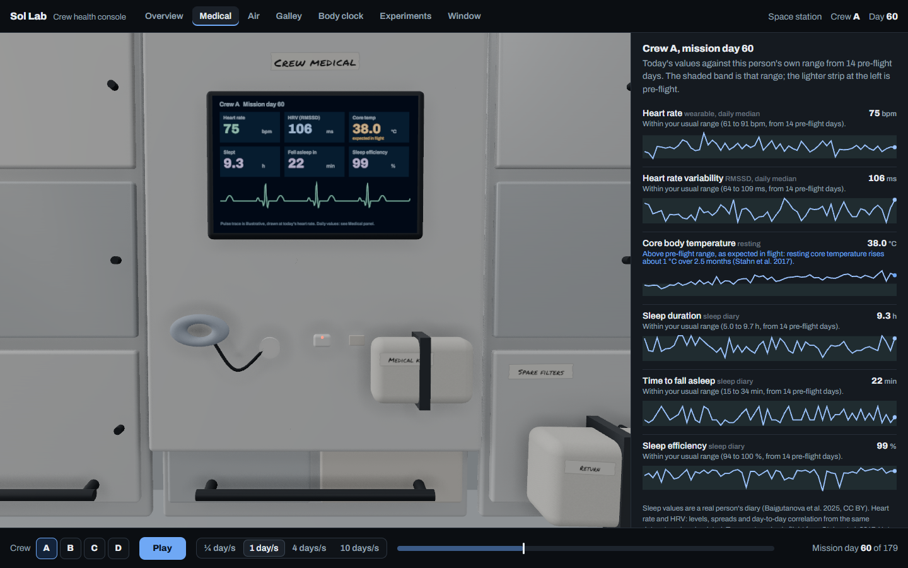
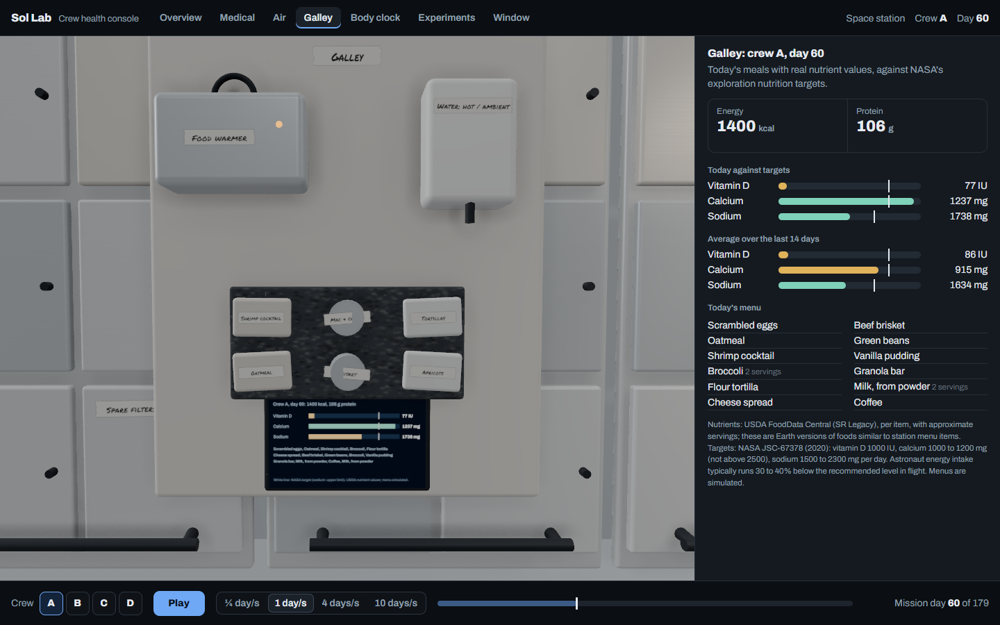
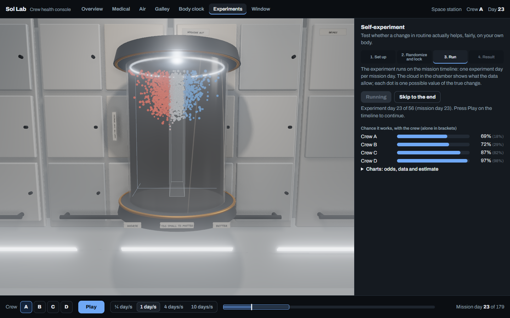
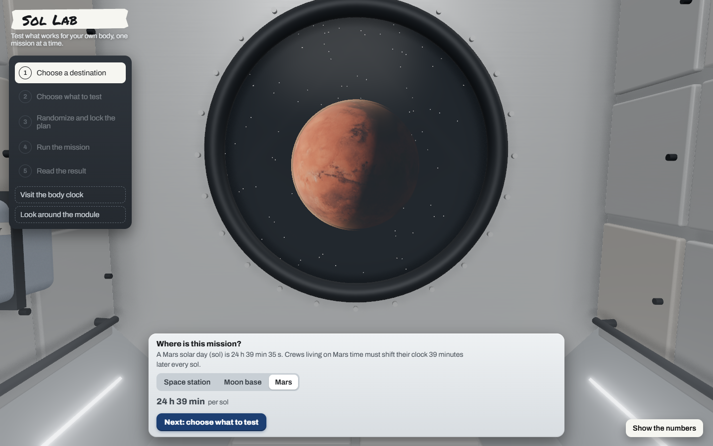

# Sol Lab

**NASA Space Apps 2026, "Create Health Monitoring Software for Astronauts on Space Missions."** Team owner: Palash (San Marino, CA).

Every other entry we found watches astronauts and raises alerts. Sol Lab helps a crew member find out what actually works for *their own* body during a mission: design a small, fair experiment ("does cutting caffeine after noon help me fall asleep faster?"), run it in a 3D station module, and get an honest verdict, including "not settled". A whole crew can run the same experiment, and each person's answer gets sharper from what the crew shares.

It is laid out as a crew health console: a 3D station module on the left, an inspector on the right, and a mission timeline along the bottom. Each station in the module is a working part of the tool. Keys 1 to 9 switch stations, Space plays the mission, and the overview exports a crew report.


| | |
|---|---|
|  |  |
| Medical: heart rate, HRV, core temperature and sleep for each crew member, against their own pre-flight range. Out-of-range values are marked, never alarmed. | Air: cabin CO2, 7-day average, headache risk (Law et al. 2014), temperature and humidity against NASA-STD-3001. The fan and airflow respond to CO2. |
|  |  |
| Radiation: real ISS dose readings (NASA OSDR RadLab, DOSTEL-1, 2022) on a globe; the station marker flies a real day of track through the South Atlantic Anomaly. | Bloodwork: real blood tests of the four Inspiration4 astronauts (SpaceX, 2021; NASA OSDR), each compared with their own pre-flight draws. |
|  |  |
| Galley: each day's menu with USDA nutrient values, against NASA exploration targets for vitamin D, calcium and sodium. | Experiments: a randomized self-experiment run by the whole crew; each member's chance it works, with the crew and alone. |
|  |  |
| Body clock: a published circadian model running for four crew. | Destination: real ISS orbit (SGP4, CelesTrak), Moon or Mars. |

## Run it

```bash
cd lab
npm install
npm run dev      # http://localhost:5199
npm test         # 26 tests: statistics engine, pooling, missions, orbit, crew health, real data files
npm run check    # syntax check of every file
npm run build    # static, works offline (dist/)
```

## What is new, and how we checked

- **Crew-run self-experiments for spaceflight.** We found no N-of-1, single-case or crew-run randomized self-experiment work in spaceflight or analog missions, and none among about ten public Space Apps 2026 repos for this challenge (search on 2026-11-01; private work cannot be ruled out). N-of-1 apps and pooled N-of-1 trials exist on Earth; the spaceflight crew application is the new part. Details: [docs/STUDIES_RESULTS.md](docs/STUDIES_RESULTS.md).
- **Validated, not just built.** Three studies were pre-registered before running ([docs/STUDIES_PREREG.md](docs/STUDIES_PREREG.md)):
  - On 49 real people's sleep diaries, the engine made a false call 0.68% of the time when nothing was there, its 95% intervals covered 94.7% to 97.3%, and the in-app power preview matched real-data power within 4 points.
  - Crew pooling cut each person's error by 20% to 45%. Our first pooling method failed its coverage bar (83% to 86%); the fixed method, pre-registered after that failure, passed (90.9% to 97.8%).
  - The circadian model failed one pre-registered check against a 2007 human Mars-sol study; the app says so.
- **Honest about limits.** A single four-week self-experiment usually ends "not settled" (about 10% to 14% of the time it settles a change 1.5 times the smallest worthwhile one). The app shows this before you start.

## Where things are

- `lab/`: the app and its tests ([lab/README.md](lab/README.md) explains what is real and what is simulated)
- `docs/design.md`: concept, features, art direction
- `docs/STUDIES_PREREG.md`, `docs/STUDIES_RESULTS.md`: validation studies
- `docs/BUILD_LOG.md`: every decision made during the build, with reasons
- `docs/PITCH.md`: 30-second summary, demo script, claims we can and cannot make
- `analysis/`: all study outputs and simulations
- `research_notes/`: judging research, competitor field, idea screening, evidence
- `archive/`: earlier concepts (CALLSIGN, ECHO), kept for the record

## Data and credits

Open wearable and sleep-diary data (Baigutanova et al. 2025, CC BY), USDA FoodData Central nutrient values (public domain), NASA OSDR RadLab ISS radiation readings and Inspiration4 bloodwork, CelesTrak ISS elements, NASA Visible Earth imagery, Solar System Scope textures (CC BY). Full list: [lab/public/CREDITS.md](lab/public/CREDITS.md). Built with Claude Code (AI) assistance, disclosed as the Space Apps rules require. Not a medical device.
