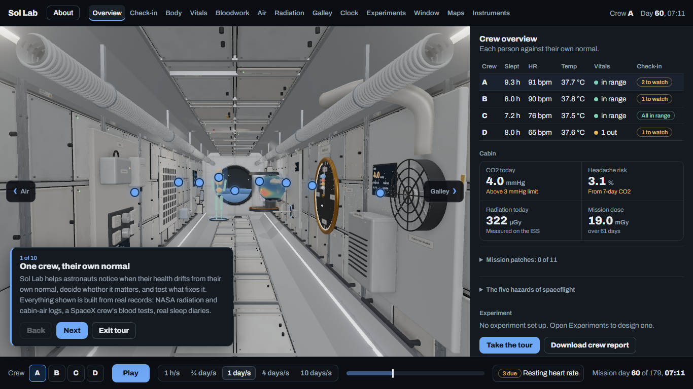
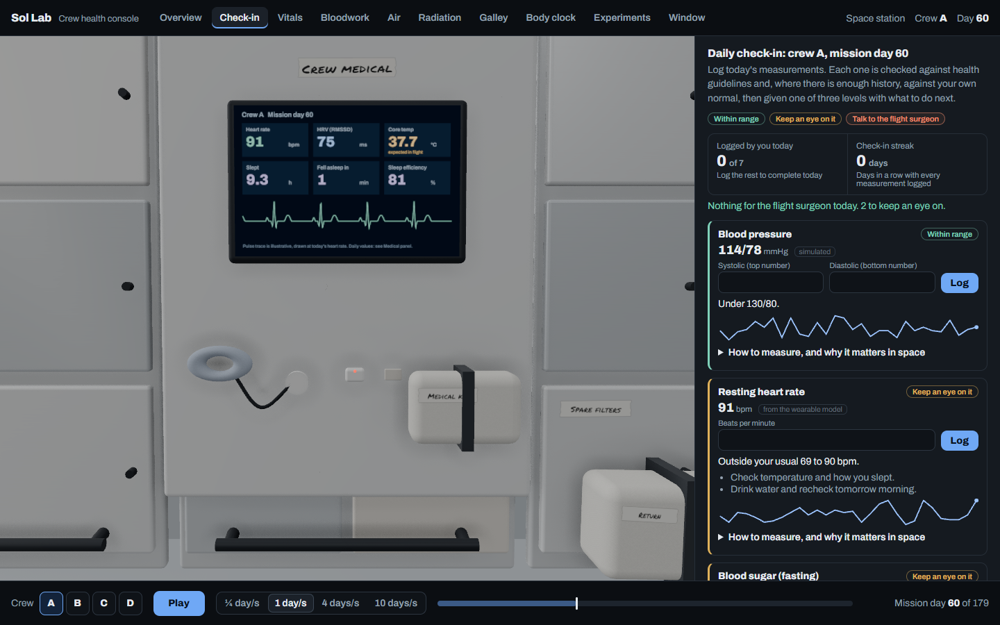
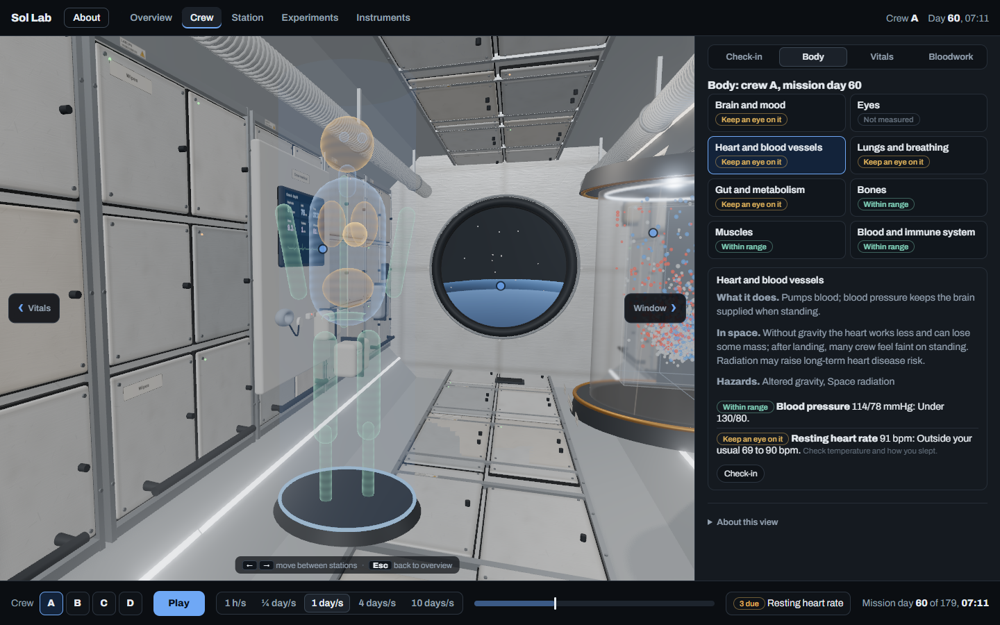
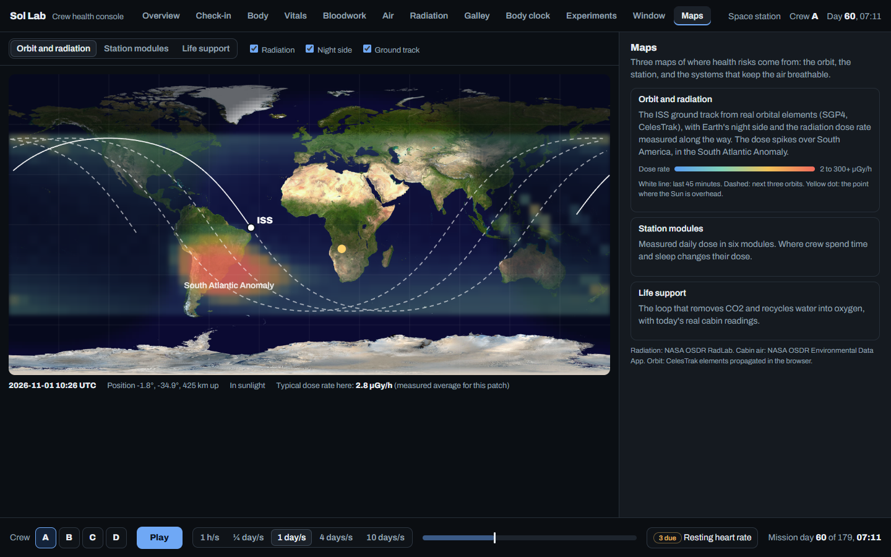
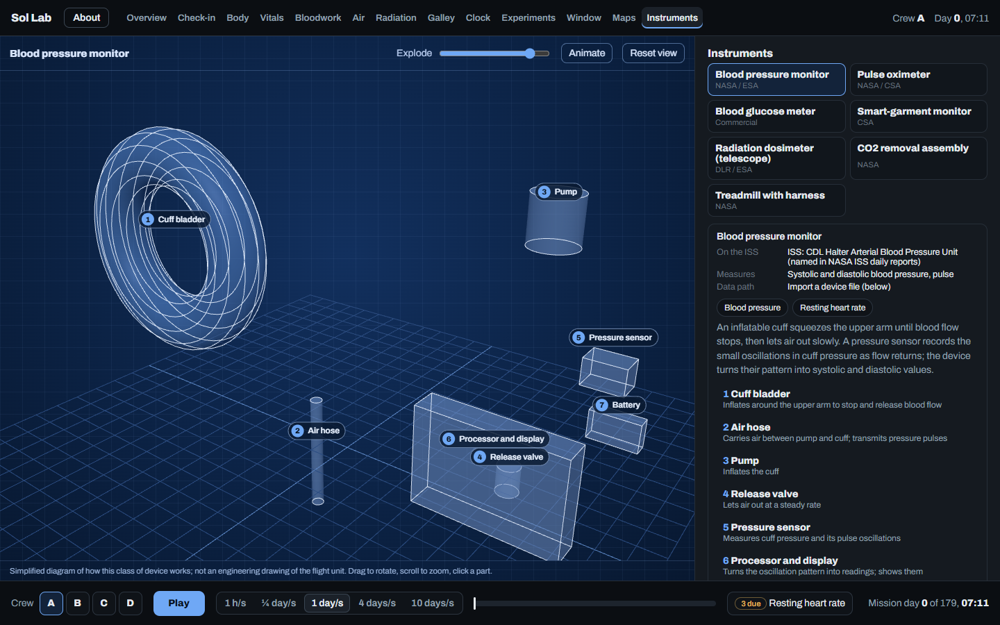
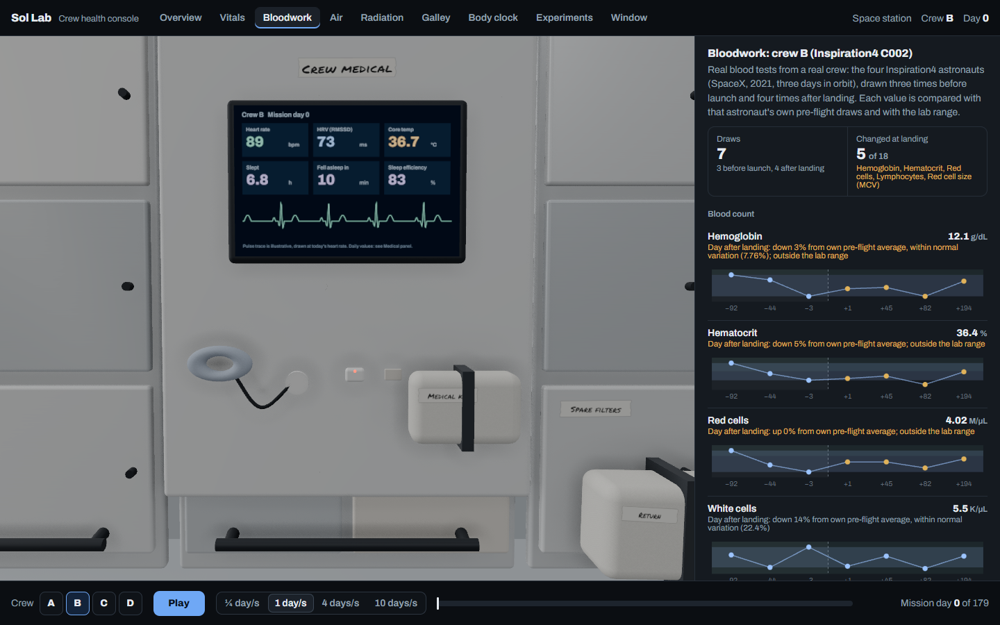
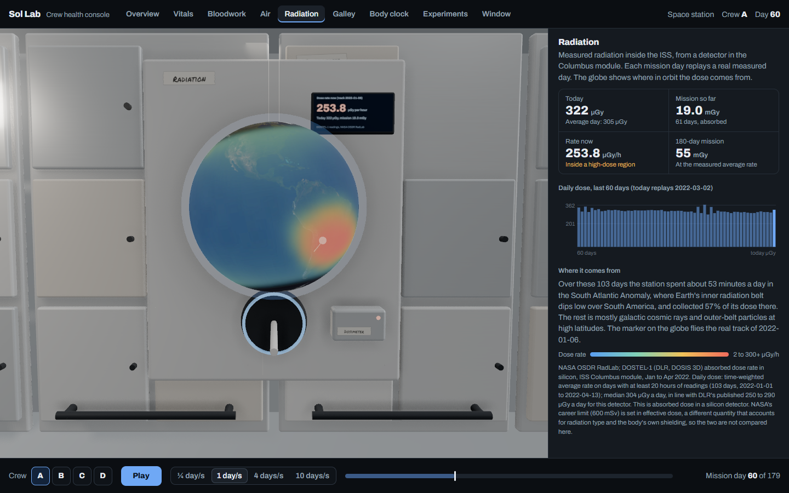
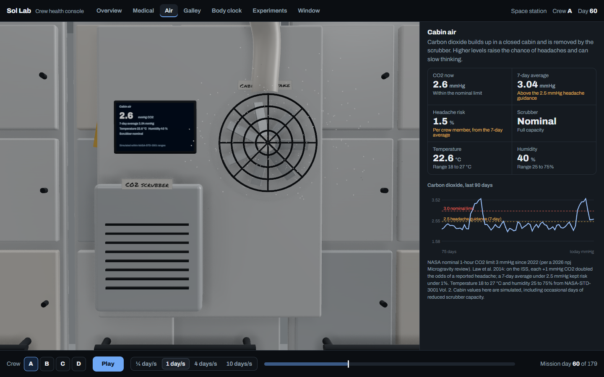
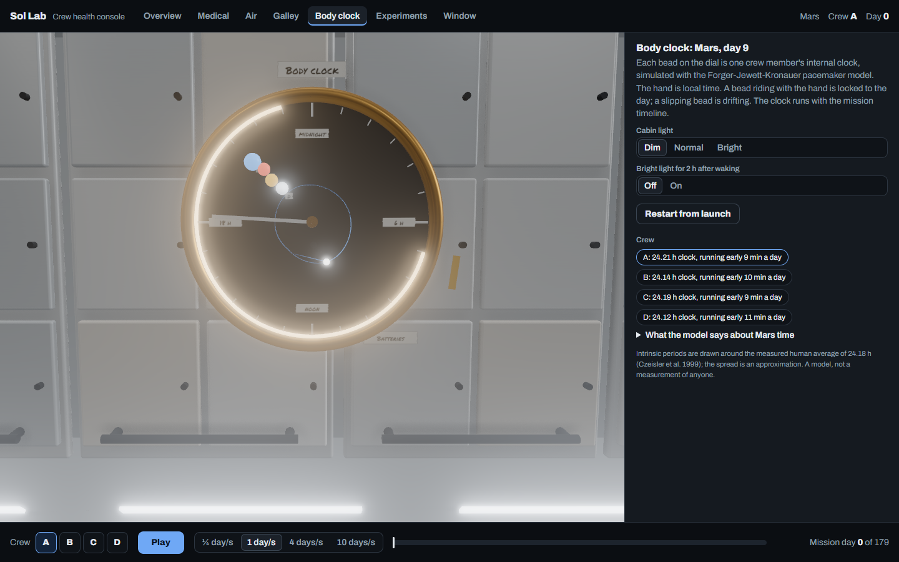

# Sol Lab

**A daily health check-in for astronauts that compares every reading with their own normal, says plainly what to do and when to call the flight surgeon, and helps them test what actually fixes it.**

NASA Space Apps 2026, "Create Health Monitoring Software for Astronauts on Space Missions". Team: Palash (owner) and ktm331, San Marino, CA.

**Try it:** `https://palashraks-afk.github.io/NASA-Space-Apps/` (live once Pages is switched on, see below). It opens with a 10-step guided tour.



## Gather, evaluate, act

| Gather | Evaluate | Act |
|---|---|---|
|  |  |  |
| A two-minute daily check-in: blood pressure, heart rate, blood sugar, temperature, sleep, mood, exercise. Typed in, or imported from any device as CSV or FHIR. Timed reminders follow the daily routine. | Each value is compared with that person's own normal and given one of three calm levels: within range, keep an eye on it, talk to the flight surgeon. A clickable 3D body shows which parts are affected and how spaceflight changes them. | Every non-normal level comes with what to do next. When something keeps drifting, the crew runs a fair self-experiment and gets an honest verdict, including "not settled". |

## Why it matters

On a Mars mission a message to Earth takes up to 22 minutes each way, so crews must judge their own health. Population ranges miss changes that are large for one person but normal for another; comparing each astronaut with their own normal catches them earlier, and a fair self-test stops a crew member trusting a lucky streak. The same approach helps people far from a doctor on Earth: Antarctic and offshore crews, rural patients, anyone tracking a long-term condition at home.

## Built on real data

| Record | Source | In the app |
|---|---|---|
| 123,695 ISS radiation readings, plus daily dose in six modules | NASA OSDR RadLab (DLR DOSTEL, REM detectors) | Radiation globe, module map, orbit map |
| 358 days of ISS cabin CO2, temperature and humidity | NASA OSDR Environmental Data App | Air station, life-support map, headache risk |
| Blood tests of the four Inspiration4 astronauts, before and after flight | NASA OSDR OSD-569, OSD-575 (SpaceX mission) | Bloodwork |
| Sleep diaries of 49 people | Baigutanova et al. 2025, CC BY | Sleep values, experiment validation |
| Nutrients of 19 foods | USDA FoodData Central | Galley |
| ISS orbital elements | CelesTrak, propagated with SGP4 | Window, ground track |

Where nobody logged a value, it is simulated and labelled "simulated" on screen. Records from different people and years are combined into one mission.

## How it answers the brief

| The brief asks | Where |
|---|---|
| Gather indicators (keyboard, clicks, files) | Check-in; Instruments import |
| Evaluate status, colour at a glance | Three levels everywhere; overview; body figure |
| Guidance on treatment and improvement | Actions on every non-normal level; experiments |
| When to involve the flight surgeon | "For the flight surgeon" box |
| Blood pressure, heart rate, blood sugar, temperature, sleep, mood | All six, plus exercise |
| Five hazards of spaceflight | Overview, each linked to its stations |
| Clickable human figure | Body |
| Routine prompts, gamification, charts, instructions | Reminders, mission patches, every station, "How to measure" on every card |

## Validated, not just built

- On 49 real people's sleep diaries the self-experiment engine made a false call 0.68% of the time; its 95% intervals covered 94.7% to 97.3% (pre-registered, [docs/STUDIES_RESULTS.md](docs/STUDIES_RESULTS.md)).
- Two pre-registered checks failed and are reported, not hidden: a first pooling method under-covered (fixed and re-tested), and the circadian model locks onto a Mars day more easily than a 2007 human study found.
- Guidance cut-offs follow ACC/AHA, ADA, CDC, AHA and AASM; where no published cut-off exists, the team's choice is marked for clinician review.
- 38 automated tests; every push is checked, tested and built.

## More screens

| | |
|---|---|
|  |  |
| Maps: real ISS ground track over day and night with the measured dose rate; a module dose map; the life-support loop. | Instruments: the real ISS hardware behind each reading as exploded blueprints ([docs/INSTRUMENTS.md](docs/INSTRUMENTS.md)). |
|  |  |
| Bloodwork: Inspiration4 astronauts against their own pre-flight draws. | Radiation: the globe lights up over the South Atlantic Anomaly. |
|  |  |
| Air: real ISS CO2 against the 3 mmHg limit. | Body clock: a published circadian model for four crew. |

## Run it

```bash
cd lab
npm install
npm run dev      # http://localhost:5199
npm test         # 38 tests: statistics engine, pooling, missions, orbit, crew health, guidance, real data files
npm run check    # syntax check of every file
npm run verify   # check + tests + production build
npm run build    # static, works offline from any folder (dist/)
```

## Novelty

We found no crew-run randomized self-experiment tool for spaceflight or analog missions in public sources, and none among the public entries for this challenge (searched 2026-11-01; private work cannot be ruled out). Self-experiments (N-of-1 trials) exist on Earth; applying them to a crew in flight, alongside personal-baseline monitoring on real mission data, is the new part.

## Where things are

- `lab/`: the app and its tests ([lab/README.md](lab/README.md) explains what is real and what is simulated)
- `docs/design.md`: concept, features, art direction
- `docs/STUDIES_PREREG.md`, `docs/STUDIES_RESULTS.md`: validation studies
- `docs/BUILD_LOG.md`: every decision made during the build, with reasons
- `docs/PITCH.md`: one sentence, 30-second version, demo script, how it answers the brief, claims we can and cannot make
- `docs/GAP_ANALYSIS.md`, `docs/JUDGE_REVIEW.md`: honest scoring against the criteria and what was fixed
- `analysis/`: all study outputs and simulations
- `research_notes/`: judging research, competitor field, idea screening, evidence
- `archive/`: earlier concepts (CALLSIGN, ECHO), kept for the record

## Publish it (GitHub Pages)

`.github/workflows/pages.yml` checks, tests and builds every push, and deploys `main` to GitHub Pages. One-time setup by the repo owner: make the repository public (Space Apps requires open source anyway; Pages on a private repo needs a paid plan), then Settings > Pages > Source: **GitHub Actions**. The site appears at `https://palashraks-afk.github.io/NASA-Space-Apps/`.

## 3D models

Teammates can drop `.glb` files into `lab/public/models/` and list them in `models.json` to replace any station's built-in shapes or the body figure. See [docs/MODELS.md](docs/MODELS.md).

## Licence

Code: Apache 2.0 ([LICENSE](LICENSE)). Data and textures keep their own licences, listed in [lab/public/CREDITS.md](lab/public/CREDITS.md).

## Data and credits

Open wearable and sleep-diary data (Baigutanova et al. 2025, CC BY), USDA FoodData Central nutrient values (public domain), NASA OSDR RadLab ISS radiation readings and Inspiration4 bloodwork, CelesTrak ISS elements, NASA Visible Earth imagery, Solar System Scope textures (CC BY). Full list: [lab/public/CREDITS.md](lab/public/CREDITS.md). Built with Claude Code (AI) assistance, disclosed as the Space Apps rules require. Not a medical device.
